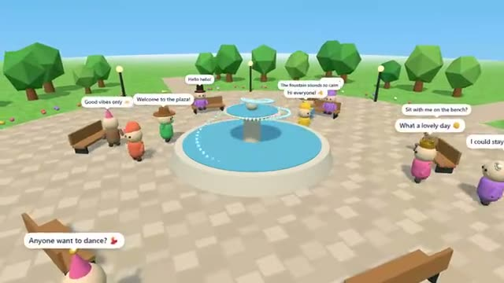

# Hangout Plaza

Walk around, chat and emote. A multiplayer starter game from [Multiplayer Agent](https://multiplayeragent.com): 3D, drop-in, 2–30 players, with friendly bots that fill the plaza.

## How it plays

Pick a color and a hat, then stroll around a little plaza with a fountain, benches and trees. Chat in speech bubbles, wave, dance, jump or sit on a bench.

**Controls:** WASD or tap the ground to walk, drag to look around, Enter to chat, 1 to 4 or the 😀 button for emotes.

## Make it yours in the Game Builder

Open the [Game Builder](https://multiplayeragent.com), choose **Start from a starter game** and pick Hangout Plaza. It opens as version 1 in your studio, ready to play and publish. Then ask for changes, for example:

- Add a dance floor with music
- Add more hats and a shop to buy them
- Add a mini game in one corner

## Run it yourself

1. Get a free publishable key (`pk_…`) at [multiplayeragent.com](https://multiplayeragent.com).
2. In `index.html`, put it in place of `pk_REPLACE_ME` in the `MP_CONNECT` block.
3. Serve the folder (for example `npx serve`) and open it. The 3D engine loads as a module, which browsers block from a file on disk.

Without a key it still runs, offline with the bots.

## How it is built

- One `index.html` plus three.js in `libs/`. The comment at the top of the script maps the code and explains the multiplayer.
- Chat lines go out as events and your last line stays on your player, so people who arrive later still see it.
- **Live sync:** Everyone walks, chats and emotes in the same plaza at once.
- **Bots:** Friendly bots wander, sit, dance and say hi until people arrive.
- **Moderation:** Mute anyone from the people list; it hides their chat on your screen.
- `?attract` runs it offline with bots only. The preview video is recorded from it.

## License

MIT. three.js in `libs/` is MIT too (Copyright 2010-2024 three.js authors).
